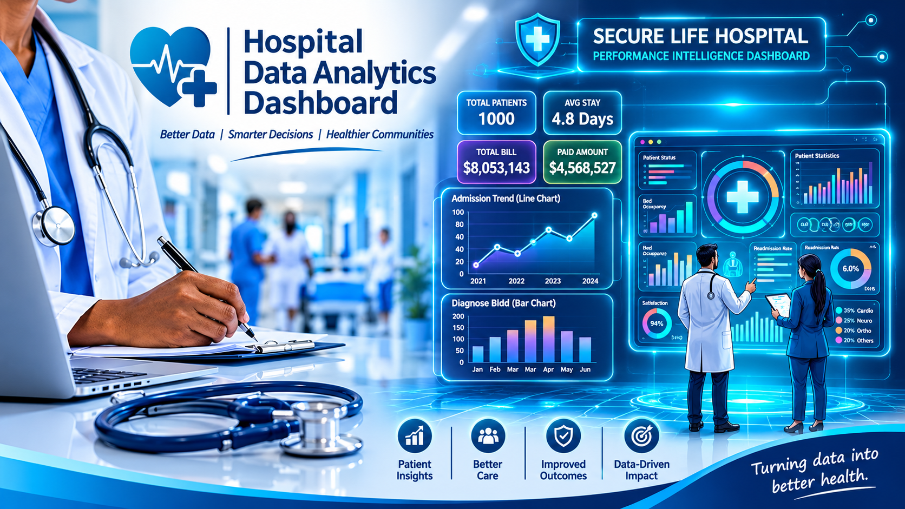
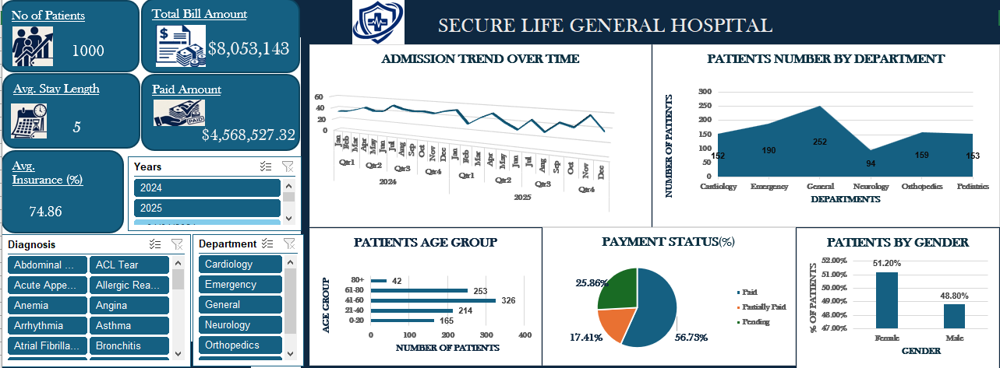

# A DATA DRIVEN PERFORMANCE ANALYSIS OF SECURE LIFE GENERAL HOSPITAL 2024-2025
## INTRODUCTION

This project is one of the projects I completed as part of the Data Analytics Track of the FadaQa Tech Scholarship Program. I worked as a Data Analyst for Secure Life General Hospital, a fictional hospital, to turn raw patient admission, billing and insurance data into an interactive dashboard that supports management decision-making. The project analyzes operational performance, patient demographics, department workload, and financial revenue for Secure Life General Hospital.

## ABOUT THE DATASET

The Secure Life Hospital Patient Dataset (2024–2025) is a structured operational dataset designed to simulate real-world hospital administrative workflows. It contains comprehensive, row-level tracking across key metrics:

  -  **Patient Demographics & Admissions**: Patient IDs, age categories, gender, admission dates, and departments (General, Emergency, Orthopedics, Pediatrics, Cardiology, Neurology).
  - **Clinical & Operational Metrics**: Length of stay (measured in days) and diagnosis classifications.
  - **Financial & Billing Records**: Total bill amounts, insurance coverage percentages, and payment status tracking (Paid, Pending, Partially Paid), supported by custom helper columns isolating collected revenue. *To view data set* :[click here](https://docs.google.com/spreadsheets/d/1o_LZL6Oj9-1NKanb80U8rt5u7bxpZTFV/edit?usp=sharing&ouid=100476281834424122222&rtpof=true&sd=true)

## PROBLEM STATEMENT

Modern healthcare administration requires a delicate balance between high-quality patient care and financial sustainability. Hospital management must constantly monitor bed occupancy, departmental patient volume, and revenue collection efficiency. The management of Secure Life General Hospital observed changes in patients’ admissions, outstanding medical bills and insurance coverage across departments. However, the hospital had no consolidated report giving a clear picture of its operational and financial performance. This project seeks to explore operational patterns and financial inflows across Secure Life General Hospital, evaluating key areas such as: Departmental patient load and length of stay efficiency, Total billing vs. actual collected revenue (payment status breakdown), Patient demographic distributions across age and gender categories and Admission trends over a multi-year timeline (2024–2025).This project transforms the raw data into an interactive dashboard that helps management:

i. Count the patient visits recorded

ii. Identify departments with the highest patient volume

iii. Identify departments generating the highest total bills

iv. Understand average length of stay across departments

v. See the proportion of bills that are paid, pending or partially paid

vi. Track how much has been billed and how much remains outstanding

vii. Understand how insurance coverage varies by department and diagnosis

viii. Identify the age groups with the most visits

ix. Observe how admissions and billing change over time

x. Highlight areas that may require management attention
## VISUALISATION
Microsoft Excel was used to design, model, and develop an executive, interactive dashboard powered by dynamic pivot tables, custom helper columns, and a clean navy-blue and white corporate theme.

## INSIGHTS
1. **Patient Visits and Billing**: The hospital recorded 1,000 patient visits with a total billed amount of $8,053,143. The average length of stay was 5 days and the average insurance coverage was 74.86%.
2. **Departments by Patient Volume**: The General department received the most patients, followed by Emergency. Neurology received the fewest.
  - General — 252
  - Emergency — 190
  - Orthopedics — 159
  - Pediatrics — 153
  - Cardiology — 152
  - Neurology — 94
3. **Payment Status**: Only 56.73% of bills are fully paid. 17.41% are partially paid and 25.86% are still pending, meaning about 43% of visits have an unsettled bill. Paid amounts total $4,568,527.32, leaving roughly $3.48 million not yet recorded as paid (billed amount minus paid amount; this may include part-payments on partially paid bills).
4. **Age Groups**: The 41-60 age group accounts for the most visits (326), followed by 61-80 (253) and 21-40 (214). Together, patients aged 41-80 make up 57.9% of all visits. Patients aged 80+ account for the fewest (42).

  - 80+ — 42
  - 41-60 — 326
  - 61-80 — 253
  - 21-40 — 214
  - 0-20 — 165

5. **Gender**: Visits are almost evenly split, with 51.2% female and 48.8% male, so no meaningful gender imbalance was observed.
Admission Trend (2024 - 2025): Monthly admissions show a downward trend over the two years, with noticeable dips in 2025. This is worth investigating to determine whether it reflects seasonality, capacity issues or changes in referrals.
## RECCOMENDATIONS FOR MANAGEMENT
1. **Improve bill collection**: With over a quarter of bills pending and 17% partially paid, the hospital should introduce payment reminders, instalment plans and faster insurance claim follow-up.
2. **Plan capacity around General and Emergency**: These departments carry the highest patient load, so staffing and bed allocation should prioritize them.
3. **Investigate the decline in admissions**: Review the 2025 drop by department and diagnosis to find its cause and decide on a response.
4. **Target services at the 41-80 age group**: This group makes up the majority of visits, so preventive care and chronic-condition programs could be focused here.
5. **Review low-volume departments**: Neurology has the fewest visits. Management should check whether this reflects low demand, limited capacity or referral gaps.
## RECOMMENDATIONS FOR FURTHER ANALYSIS
The following recommendations highlight additional metrics and data integrations that could expand this analysis to drive deeper clinical and financial intelligence:
 1. **Incorporate Readmission Rates**: Tracking patient readmission within 30 days of discharge would provide critical insights into clinical care quality and treatment efficacy across different departments.
 2. **Detailed Insurance Provider Breakdown**: Expanding financial analysis to categorize revenue recovery by specific insurance providers or third-party payers would help optimize corporate billing agreements and reduce claim rejection rates.
## CONCLUSION
Building this hospital performance dashboard demonstrated the immense value of transforming raw clinical data into clear, actionable executive insights. By combining structured financial isolation logic (IF statements for paid collections) with a minimalist visual design, hospital leadership can instantly track patient volume, revenue realization, and operational bottlenecks.
To conclude, the following reflections are worth noting:
 1. Data transparency in hospital billing ensures tighter revenue cycle management.
 2. A dashboard is only useful when it ends in clear, actionable recommendations.
 3. Continuous exploration of operational data empowers healthcare providers to optimize patient care and administrative efficiency.
 3. A dashboard is only useful when it ends in clear, actionable recommendations.
 4. Continuous exploration of operational data empowers healthcare providers to optimize patient care and administrative efficiency.
